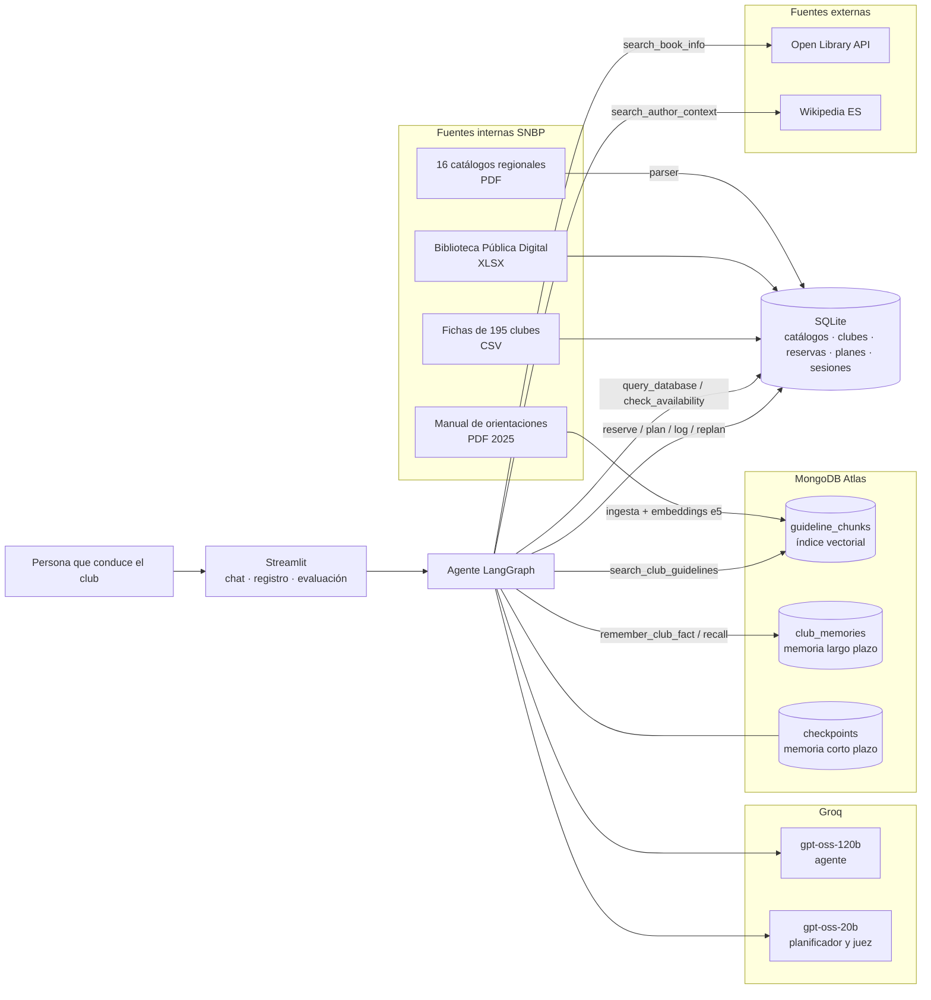
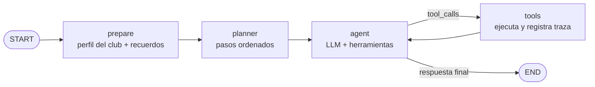

# Arquitectura

## Componentes

| Componente | Tecnología | Por qué |
|---|---|---|
| Orquestación | LangGraph `StateGraph` explícito | Estado, nodos y aristas visibles; checkpoints por `thread_id` |
| LLM | Groq: `gpt-oss-120b` (agente), `gpt-oss-20b` (planificador, juez) | Llamadas a herramientas confiables y baja latencia; modelos separados por límite de tokens por minuto |
| Embeddings | `intfloat/multilingual-e5-small` local (384 dim.) | Gratis, multilingüe (español), sin depender de otra API |
| Base vectorial | MongoDB Atlas Vector Search | Visto en el curso; también guarda memoria y checkpoints |
| Datos tabulares | SQLite + text-to-SQL de solo lectura | Los catálogos son tablas: SQL responde conteos y filtros exactos que un RAG no garantiza |
| Interfaz | Streamlit | Chat con trazabilidad y pestaña de evaluación |

## Flujo del agente

- **prepare:** reinicia la traza del turno, carga el perfil del club desde SQLite y recupera de Atlas los recuerdos del club más parecidos a la solicitud.
- **planner:** si la solicitud tiene varias acciones, la descompone en pasos ordenados por dependencia (primero consultar estado y disponibilidad, luego escribir, al final resumir). Para saludos o preguntas simples devuelve un plan vacío.
- **agent:** el LLM decide qué herramienta usar siguiendo el plan y las reglas del prompt.
- **tools:** ejecuta las herramientas y guarda nombre, argumentos y resultados para mostrarlos en la interfaz.

El club sobre el que se actúa se inyecta desde el estado (`InjectedState`): el modelo no puede reservar ni registrar a nombre de otro club.

## Herramientas

| Tipo | Herramienta | Fuente |
|---|---|---|
| Consulta | `search_club_guidelines` | Manual SNBP (RAG, Atlas) |
| Consulta | `query_database` | SQLite (text-to-SQL de solo lectura) |
| Consulta | `check_availability`, `get_club_status` | SQLite |
| Consulta | `search_book_info` | Open Library (externa) |
| Consulta | `search_author_context` | Wikipedia (externa) |
| Escritura | `reserve_copies`, `create_reading_plan`, `log_session`, `replan_reading`, `cancel_reading_plan` | SQLite |
| Escritura | `remember_club_fact` | Atlas (memoria largo plazo) |
| Escritura | `save_session_guide` | Archivo Markdown |

Las reglas de negocio están en código (`bookclub/records.py`), no en el prompt: solo se reservan títulos de la región del club, nunca más copias que las disponibles en esas fechas, un plan activo por club.

## Memoria

| Tipo | Dónde | Qué guarda |
|---|---|---|
| Corto plazo | Checkpointer `MongoDBSaver`, por `thread_id` | Historial de la conversación (se recortan los últimos 16 mensajes al enviar al LLM) |
| Largo plazo | Colección `club_memories` en Atlas, con embeddings | Preferencias, acuerdos y avances del club; se recuperan por similitud y filtrados por club |
| Registro estructurado | SQLite | Reservas, planes, sesiones y su estado |

## Decisiones adaptativas

| Condición | Comportamiento |
|---|---|
| El título no está en el catálogo de la región | No reserva; propone títulos de la región o la Biblioteca Pública Digital |
| No hay copias suficientes en esas fechas | Informa cuántas hay y propone otras fechas u otro título |
| El grupo va atrasado (`log_session` → `pages_behind`) | Avisa y ofrece reprogramar con `replan_reading` |
| El club ya tiene un plan activo | No crea otro; ofrece reprogramar o cancelar |
| La herramienta falla (red, SQL inválido) | El error vuelve al modelo como mensaje, que explica y corrige |
| El modelo genera una llamada mal formada | El nodo `agent` se reintenta (hasta 3 veces) |
